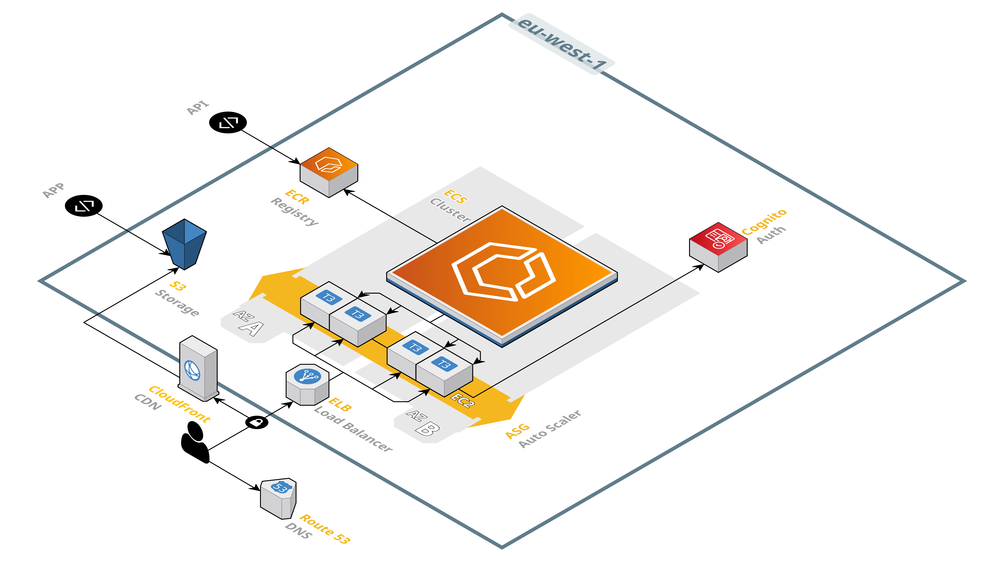

# App Template

## Table of Contents

1. [Overview](#overview)
2. [Architecture](#architecture)
3. [Technology Stack](#technology-stack)
   - [Backend](#backend)
   - [Frontend](#frontend)
   - [Codegen](#codegen)
4. [Repository Structure](#repository-structure)
5. [Getting Started](#getting-started)
   - [Backend Setup](#backend-setup)
   - [Frontend Setup](#frontend-setup)
   - [Codegen Setup](#codegen-setup)
6. [Environment Variables](#environment-variables)
   - [Env File](#env-file)
7. [Backend Modules](#backend-modules)
   - [Core](#core)
   - [Authentication & Authorization](#authentication--authorization)
   - [User & Account Management](#user--account-management)
   - [AWS Service Wrappers](#aws-service-wrappers)
   - [Cross-Cutting Layers](#cross-cutting-layers)
8. [API](#api)
   - [Conventions](#conventions)
   - [Error Codes](#error-codes)
   - [Endpoints](#endpoints)
9. [Authentication](#authentication)
   - [Cognito Configuration](#cognito-configuration)
   - [App Clients](#app-clients)
10. [Authorization Model](#authorization-model)
    - [Authentication Methods](#authentication-methods)
    - [Roles](#roles)
11. [Data Model](#data-model)
    - [Users](#users)
12. [Frontend Application](#frontend-application)
13. [Code Generation](#code-generation)
14. [Infrastructure & Deployment](#infrastructure--deployment)
    - [Environments](#environments)
    - [Terraform Modules](#terraform-modules)
    - [State Management](#state-management)
    - [Deployment Steps](#deployment-steps)
    - [Environment Configuration](#environment-configuration)
15. [Development Workflow](#development-workflow)
    - [Versioning System](#versioning-system)
    - [Testing](#testing)
    - [Code Quality](#code-quality)
16. [Deriving a Project](#deriving-a-project)

---

## Overview

**App Template** is the starting point for a cloud application. It provides a working account system — sign-up, sign-in, email and phone verification, password recovery, profile management and an admin user listing — on top of a deployable AWS infrastructure, so that a new project starts from a running application instead of an empty repository.

The repository is a monorepo containing three components that share a single version and a single API contract:

| Component | Language | Role |
|---|---|---|
| `backend` | TypeScript (NestJS) | REST API, Cognito-backed account management |
| `frontend` | TypeScript (React) | Web application |
| `codegen` | Python | Generates typed API models from the OpenAPI spec |

The backend is the single source of truth for the API contract: it emits `backend/openapi.json`, and `codegen` projects that spec into TypeScript models for the frontend. The template carries no domain model of its own — everything above the user account is left for the derived project to add.

---

## Architecture



The system is deployed on **AWS (eu-west-1)** and follows a classic cloud-native architecture:

| Layer | Service | Purpose |
|---|---|---|
| **DNS** | Route 53 | Domain resolution |
| **Certificates** | ACM | TLS certificates, looked up rather than provisioned |
| **CDN** | CloudFront | Static asset delivery & caching |
| **Storage** | S3 | Frontend site bucket |
| **Load Balancing** | ELB | Traffic distribution |
| **Compute** | ECS (on EC2 via ASG) | Containerized backend |
| **Container Registry** | External | Images are pulled from `API_IMAGE_URL`. No ECR repository is provisioned |
| **Auth** | Cognito | User authentication (OpenID Connect) |

There is no database in the template. Cognito is the only datastore, holding the user directory; a derived project adds its own persistence layer.

---

## Technology Stack

### Backend

| Technology | Details |
|---|---|
| Runtime | Node.js (ESM, `"type": "module"`) |
| Framework | NestJS |
| Language | TypeScript |
| Package Manager | npm |
| Validation | class-validator + custom `ValidationPipe` |
| Serialization | class-transformer |
| API Documentation | @nestjs/swagger (OpenAPI 3.1.0) |
| Events | @nestjs/event-emitter |
| Date/Time | Moment.js |
| Reactive | RxJS |
| Utilities | es-toolkit, uuid, dotenv, reflect-metadata |
| Testing | Jest (ts-jest, ESM preset) |
| AWS SDKs | Cognito |

### Frontend

| Technology | Details |
|---|---|
| Runtime | Node.js |
| Build Tool | Vite |
| Framework | React |
| Language | TypeScript |
| UI Library | Material UI (MUI) + MUI Icons |
| State Management | Jotai |
| HTTP Client | Axios |
| Drag & Drop | @hello-pangea/dnd |
| QR Code | qrcode |
| Notifications | react-hot-toast |
| Browser Detection | bowser |
| Phone Validation | libphonenumber-js |
| Utilities | es-toolkit |
| Styling | Emotion (CSS-in-JS) |

### Codegen

| Technology | Details |
|---|---|
| Language | Python 3 |
| Input | OpenAPI 3.1.0 (`backend/openapi.json`) |
| Intermediate Representation | Dataclass-based IR (`codegen/ir.py`) |
| Targets | `ts` |

---

## Repository Structure

```
app-template/
├── backend/          # API server
│   ├── src/          # Application source
│   ├── tests/        # Test suites
│   ├── scripts/      # install / run / build / test / spec scripts
│   └── openapi.json  # Generated OpenAPI specification
├── frontend/         # Web application
│   ├── src/          # Application source
│   ├── public/       # Static assets + runtime config.json
│   └── scripts/      # install / run / build scripts
├── codegen/          # OpenAPI to TypeScript model generator
│   ├── frontend/     # Parser (OpenAPI -> IR)
│   └── backend/      # Emitters (IR -> language)
├── infrastructure/   # Infrastructure as code
│   ├── environments/ # Infrastructure environments
│   └── scripts/      # plan / deploy scripts
├── scripts/          # Project scripts (version, codegen)
└── docs/             # Project documentation
```

---

## Getting Started

Each module is driven by Python scripts under its own `scripts/` directory, so that every toolchain is invoked the same way:

| Module | Scripts |
|---|---|
| `backend` | `install.py`, `run.py`, `build.py`, `test.py`, `spec.py` |
| `frontend` | `install.py`, `run.py`, `build.py` |
| `infrastructure` | `plan.py`, `deploy.py` |
| repository root | `version.py`, `codegen.py` |

### Backend Setup

Based on [Node.js](https://nodejs.org/), [TypeScript](https://www.typescriptlang.org/) and [NestJS](https://nestjs.com/).

Requirements:
* Node.js (v22+ recommended for ESM compatibility)
* npm

Configuration:
```
backend/.env
```

An example configuration is provided in `backend/.env.example`.

Install:
```
python ./backend/scripts/install.py
```
```
cd backend
npm install -g @nestjs/cli
npm install
```

Run:
```
python ./backend/scripts/run.py
```
```
cd backend
npm run start
npm run start:dev
npm run start:debug
npm run start:prod
```

Build:
```
python ./backend/scripts/build.py
```
```
cd backend
npm run build
```

Test:
```
python ./backend/scripts/test.py
```
```
cd backend
npm run test
npm run test:watch
npm run test:cov
```

Generate the OpenAPI specification:
```
python ./backend/scripts/spec.py
```
```
cd backend
npm run spec
```

### Frontend Setup

Based on [Node.js](https://nodejs.org/), [Vite](https://vite.dev/), [TypeScript](https://www.typescriptlang.org/), [React](https://react.dev/) and [Material UI](https://mui.com/).

Requirements:
* Node.js (v22+ recommended)
* npm

Configuration:
```
frontend/public/config.json
```

```
{
	"endpoint": "http://localhost:9000"
}
```

Install:
```
python ./frontend/scripts/install.py
```
```
cd frontend
npm install
```

Run:
```
python ./frontend/scripts/run.py
```
```
cd frontend
npm run dev
```

Build:
```
python ./frontend/scripts/build.py
```
```
cd frontend
npm run build
```

### Codegen Setup

Requirements:
* Python 3.10+

Regenerate all API models from the backend specification:
```
python ./scripts/codegen.py
```

This runs `codegen/main.py` once per target and writes:

| Target | Output |
|---|---|
| `ts` | `frontend/src/api/api.ts` |

A single target can be generated manually:
```
python codegen/main.py --target ts --spec backend/openapi.json --output frontend/src/api/api.ts
```

---

## Environment Variables

Configuration is resolved by the `ConfigService`, which reads the process environment through the `EnvService`. The template has no dynamic configuration store: everything is deployment-level and lives in the `.env` file.

### Env File

The `.env` file is used by the backend application to define runtime configurations, such as port bindings, SSL certificates, CORS settings, and AWS credentials required to start the server.

```
PROJECT
ENVIRONMENT
PORT
ENABLE_HTTPS
KEY_PATH
CERT_PATH
ENABLE_CORS
ALLOW_ORIGINS
ALLOW_CREDENTIALS
MAX_REQUEST_SIZE

AWS_ACCESS_KEY
AWS_SECRET_KEY
AWS_REGION
AWS_USER_POOL_ID
AWS_USER_POOL_API_CLIENT_ID
```

| Name | Description |
| - | - |
| PROJECT | Project name. Declared for parity with the Terraform locals, not read by the backend |
| ENVIRONMENT | Environment name. Declared for parity with the Terraform locals, not read by the backend |
| PORT | HTTP(S) listening port (defaults to `9000`) |
| ENABLE_HTTPS | Enable TLS termination in the application |
| KEY_PATH | Path to the private key, required when HTTPS is enabled |
| CERT_PATH | Path to the certificate, required when HTTPS is enabled |
| ENABLE_CORS | Enable CORS handling |
| ALLOW_ORIGINS | Allowed origins, a single value or a comma-separated list |
| ALLOW_CREDENTIALS | Allow credentialed requests. Cannot be combined with a `*` origin, the process exits on that configuration |
| MAX_REQUEST_SIZE | Maximum accepted body size (e.g. `50mb`) |
| AWS_ACCESS_KEY | AWS access key id |
| AWS_SECRET_KEY | AWS secret access key |
| AWS_REGION | AWS region (e.g. `eu-west-1`) |
| AWS_USER_POOL_ID | Cognito user pool identifier |
| AWS_USER_POOL_API_CLIENT_ID | Cognito API client identifier |

`NODE_ENV` is also read, though it is not part of the configuration surface: any value other than `production` makes `EnvService.init` dump the whole process environment to the log at startup.

`PROJECT` and `ENVIRONMENT` are carried in the file because the Terraform workspace defines the same locals and derived projects usually start naming resources with them. The template's backend never reads them, so a derived project that adds DynamoDB tables, secrets or keys should wire them through the `ConfigService` first.

---

## Backend Modules

The NestJS backend is organized into the following modules, registered in `AppModule` in three groups: `// Base`, `// API` and `// AWS`. The tables below group them by responsibility rather than by that registration order, so `DocsModule` appears under Core even though it is registered in the `// API` group.

### Core
| Module | Purpose |
|---|---|
| `EnvModule` | Process environment loading and value parsing (`dotenv`) |
| `ConfigModule` | Configuration resolution, raising `ConfigurationErrorException` on failure |
| `EventBrokerModule` | Internal event-driven communication (NestJS EventEmitter) with an `@EventHandler` decorator |
| `DocsModule` | OpenAPI document construction and Swagger UI hosting |

### Authentication & Authorization
| Module | Purpose |
|---|---|
| `AuthModule` | Sign-up/in/out, token refresh, email verification and password flows |

### User & Account Management
| Module | Purpose |
|---|---|
| `UsersModule` | Profile read and update for the authenticated user (backed by Cognito) |
| `AdminModule` | Admin-only user listing |

### AWS Service Wrappers
| Module | Purpose |
|---|---|
| `CognitoModule` | AWS Cognito SDK wrapper |

### Cross-Cutting Layers

Beyond modules, the backend applies a set of global layers registered in `AppModule`:

| Scope | Layer | Component | Purpose |
|---|---|---|---|
| Global | Middleware | `BodyParserMiddleware` | JSON and urlencoded body parsing with the configured `MAX_REQUEST_SIZE` (default `50mb`) |
| Global | Middleware | `LoggerMiddleware` | Request logging |
| Global | Pipe | `ValidationPipe` | `class-validator` based DTO validation, raising `ValidationErrorException` |
| Global | Interceptor | `SerializerInterceptor` | `class-transformer` response serialization through `ClassSerializerInterceptor` |
| Global | Filter | `ExceptionFilter` | Maps domain exceptions to HTTP status codes and `ErrorCode` values |

The remaining interceptors are applied per controller or per route with `@UseInterceptors`:

| Interceptor | Applied on |
|---|---|
| `ResponseInterceptor` | Every controller route. The two `/docs` endpoints are served by `SwaggerModule` rather than a controller, so they return the raw specification instead of the envelope |
| `PasswordInterceptor` | Auth routes handling credentials (sign-up, sign-in, sign-down, password change/confirm) |

Domain exceptions live in `src/exceptions` and each one carries an `ErrorCode`. Custom validation decorators live in `src/validation` (`IsEnum`, `IsIcon`, `IsName`, `IsPhone`, `IsRequired`, `ToArray`).

---

## API

### Conventions

* Base paths are flat and resource-oriented (`/auth`, `/users`).
* The authenticated user is addressed as `/users/me`; the bare `/users` collection is the admin listing.
* DTOs are declared per module in `*.dtos.ts`; shapes passed down to the AWS SDK are declared as DWOs in `*.dwos.ts`, keeping the API contract decoupled from the Cognito representation.
* Responses are serialized with `class-transformer` through `SerializerInterceptor`. No model in the template declares serialization decorators yet, so the interceptor is currently a pass-through; marking a field `@Exclude()` is enough to keep it out of responses.
* Every response is wrapped by `ResponseInterceptor` in an `ApiResponse` envelope carrying `version`, `endpoint`, `docs`, `timestamp` and either `data` or an `ApiError`.
* The specification is generated from the code, not maintained by hand. `npm run spec` boots the application and writes `backend/openapi.json`.
* Operation ids follow `{Controller}/{method}` (e.g. `Users/updateEmail`).
* Swagger UI is served at `/docs/openapi`, and the raw documents at `/docs/openapi.json` and `/docs/openapi.yaml`.

The OpenAPI document is enriched at build time by helpers in `src/api`:

| Helper | Purpose |
|---|---|
| `ApiEnums` | Registers TypeScript enums as reusable named schemas |
| `ApiCatalogs` | Emits constant catalogs as spec-level data |
| `ApiDiscriminators` | Declares discriminated unions |
| `ApiExtraModels` | Registers models not reachable from any controller signature |
| `ApiExtensions` | Applies custom `x-` extensions |
| `ApiPathParams` / `ApiQueryParams` / `ApiResponse` | Decorators for consistent parameter and response documentation |

`ApiCatalogs` and `ApiDiscriminators` are wired into the document builder but have no registrations in the template; they are there for derived projects that need constant catalogs or polymorphic payloads.

### Error Codes

| Code | Meaning |
|---|---|
| `generic_error` | Unclassified failure |
| `invalid_request` | Malformed request |
| `validation_error` | DTO validation failed |
| `unauthorized` | Missing or invalid credentials |
| `forbidden` | Authenticated but not authorized |
| `not_found` | Resource does not exist or is not visible to the caller |
| `email_taken` | Email already registered |
| `configuration_error` | Missing or invalid configuration variable |

### Endpoints

**Docs**

| Method | Path |
|---|---|
| GET | `/docs/openapi.json` |
| GET | `/docs/openapi.yaml` |

**Auth**

| Method | Path |
|---|---|
| POST | `/auth/sign-up` |
| POST | `/auth/sign-down` |
| POST | `/auth/sign-in` |
| POST | `/auth/sign-out` |
| POST | `/auth/refresh-token` |
| POST | `/auth/verify-email` |
| POST | `/auth/forgot-password` |
| POST | `/auth/confirm-password` |
| POST | `/auth/change-password` |

**Users**

| Method | Path |
|---|---|
| GET | `/users/me` |
| PATCH | `/users/me` |
| PATCH | `/users/me/email` |
| PATCH | `/users/me/phone` |
| PATCH | `/users/me/icon` |

**Admin**

| Method | Path |
|---|---|
| GET | `/users` |

---

## Authentication

[Cognito](https://aws.amazon.com/cognito/) is used to authenticate and authorize users.

### Cognito Configuration

The user pool is provisioned by Terraform with the following features:
* Auto-verified attribute: `email`.
* Verification code changed to verification link (`CONFIRM_WITH_LINK`).
* Keep the original email attribute active when an update is pending (`attributes_require_verification_before_update = ["email"]`).
* Password policy: minimum length 6, lowercase, uppercase and numbers required, symbols optional, temporary password valid for 7 days.
* Custom attribute: `custom:roles`, a mutable comma-separated string mapped to the `Role` enum.
* A hosted user pool domain `{project}-{environment}`.

Once the infrastructure is deployed, update the backend environment variables:
* `AWS_USER_POOL_ID=<cognito_user_pool_id>`
* `AWS_USER_POOL_API_CLIENT_ID=<cognito_user_pool_api_client_id>`

### App Clients

The authentication architecture uses 1 user pool client.
* `API Client`: Used by API clients. Auth flow `USER_PASSWORD_AUTH`, no generated client secret.

---

## Authorization Model

### Authentication Methods

The backend supports a single authentication method, applied via a flexible `AuthGuard(...methods)` mixin. The guard inspects the `Authorization` header, resolves the user from Cognito and attaches it to the request:

| Method | Header | Verification |
|---|---|---|
| `none` | *(absent)* | Anonymous access is allowed |
| `bearer` | `Bearer <jwt>` | Verified by calling Cognito with the access token |

The mixin shape is deliberate: a derived project adds OAuth or API-key methods by extending the `AuthMethod` enum and adding a branch, without changing any controller that already declares `AuthGuard(AuthMethod.Bearer)`.

### Roles

A second guard, `RolesGuard(...roles)`, gates administrative endpoints on the Cognito `custom:roles` attribute. The only role currently defined is `admin`, and the only route behind it is `GET /users`.

Both guards are composed on the route, in order:

```
@UseGuards(AuthGuard(AuthMethod.Bearer), RolesGuard(Role.Admin))
```

The template has no per-resource authorization. A derived project that shares resources between users adds its own policy layer on top of these two guards.

---

## Data Model

Data is stored in **Cognito** only. The template defines no tables of its own.

| Entity | Storage | Key Relationships |
|---|---|---|
| **Users** | Cognito | OpenID Connect standard claims + custom roles |

### Users

Cognito users are based on the [OpenID Connect specification](https://openid.net/specs/openid-connect-core-1_0.html#StandardClaims).

| Username |
| -------- |
| string   |

| name   | family_name | birthdate        | email  | email_verified | phone_number | phone_number_verified | locale | zoneinfo | picture |
| ------ | ----------- | ---------------- | ------ | -------------- | ------------ | --------------------- | ------ | -------- | ------- |
| string | string      | string (ISO8601) | string | boolean        | string       | boolean               | string | string   | string  |

| custom:roles |
| ------------ |
| string (csv) |

* Service: Cognito
* Primary key: Username

Claims are projected onto the API `User` model by `CognitoToUser`: `Username` → `id`, `family_name` → `surname`, `phone_number` → `phone`, `zoneinfo` → `timezone`, `picture` → `icon`, `custom:roles` → `roles[]`. Sign-in credentials are projected by `CognitoToAppCredentials` into an `AppCredentials` object carrying `identityToken`, `accessToken` and `refreshToken`.

---

## Frontend Application

The React frontend is composed around a chain of managers and a small custom router.

`App` mounts `AppManager` → `ThemeManager` → `ApiManager`, which contains `ToastManager` and `AppView`. `AppView` attempts a silent re-authentication and then routes:

| Route | View | Purpose |
|---|---|---|
| `/` | `MainView` or `SignInView` | Authenticated app shell, or the login screen |
| `/sign-in` | `SignInView` | User login |
| `/sign-up` | `SignUpView` | User registration |
| `/forgot-password` | `ForgotPasswordView` | Password recovery flow |
| `/error` | `ErrorView` | Error display, message passed base64-encoded in the query string |
| `*` | `ErrorView` | Not-found catch-all |

`MainView` contains `HomeView`. Two views are rendered outside the router: `LoadingView`, shown while the silent re-authentication resolves, and `LaunchView`, the centered layout wrapper that `SignInView`, `SignUpView` and `ForgotPasswordView` render their forms inside.

Structure:

| Directory | Purpose |
|---|---|
| `api/` | **Generated** API models (`api.ts` from `openapi.json`, do not edit by hand) |
| `clients/api/` | REST client: `apiClient`, request/response interceptors and one service per API tag |
| `managers/` | Cross-cutting providers: `AppManager`, `ApiManager`, `ThemeManager`, `ToastManager` |
| `states/` | Jotai atoms and hooks, one folder per domain (`app`, `user`, `admin`) |
| `views/` | Screens, nested by route |
| `components/` | Application components (main bar, dialogs, windows) |
| `core/` | Reusable UI primitives (`Router`, `Table`, `Select`, `Window`, `Field`, …), DOM hooks (`useBreakpoint`, `useResizeObserver`, …) and generic utils |
| `forms/` | Form components paired with a DFO (data form object) and a `use*Form` hook |
| `themes/` | `base`, `customLight`, `customDark` and `discord` MUI themes |
| `utils/` | Helpers (`appUtils`, `consoleUtils`, `cryptoUtils`) |

Account surfaces are implemented as windows: `SettingsWindow` (profile, preferences), `ManagementWindow` (users) and `HelpWindow`. The `MainBar` carries the account, navigation and notifications menus.

`src/model/` exists but is empty, reserved for the derived project's domain types.

---

## Code Generation

`codegen` is a small compiler that keeps the frontend in sync with the backend contract. It is organized as a classic frontend/backend pair around an intermediate representation:

| Stage | Component | Responsibility |
|---|---|---|
| Frontend | `codegen/frontend/parser.py` | Parse `openapi.json` into the IR (`ir.Spec`) |
| IR | `codegen/ir.py` | Language-agnostic dataclasses: `ObjectSchema`, `EnumSchema`, `Field`, `RefType`, `PrimitiveType`, `ArrayType`, `MapType`, `EnumMemberType` |
| Backend | `codegen/backend/*.py` | Emit language-specific models |

Emitters:

| Target | Emitter | Output | Consumer |
|---|---|---|---|
| `ts` | `typescript.py` | `frontend/src/api/api.ts` | Frontend |

Generated files carry a `@generated openapi.json` header and the contract version, and must never be edited by hand. The full workflow after an API change is:

```
python ./backend/scripts/spec.py    # backend -> openapi.json
python ./scripts/codegen.py         # openapi.json -> frontend models
```

The IR and the emitter interface are language-agnostic by design. A derived project that needs a second client adds an emitter module next to `typescript.py`, registers it in `codegen/backend/backend.py`, and adds a target entry to `scripts/codegen.py`.

---

## Infrastructure & Deployment

The project stores the infrastructure files in the `infrastructure` directory. These files are used to deploy the required infrastructure services in [AWS](https://aws.amazon.com/) using [Terraform](https://developer.hashicorp.com/terraform), an infrastructure-as-code software tool.

### Environments

- One environment: **development**
- Region: **eu-west-1** (Ireland)
- State stored in S3 with DynamoDB-based locking
- Terraform >= 1.0, AWS provider ~> 5.0

The environment is a workspace under `infrastructure/environments/{environment}`:

```
environments/development/
├── backend.tf        # S3 state backend + DynamoDB lock table
├── main.tf           # Provider and default tags
├── variables.tf      # Local configuration for the environment
├── modules.tf        # Region module instantiation
└── eu-west-1/        # Region workspace with one module per domain
```

`variables.tf` defines the environment's locals. `ENVIRONMENT` is derived from the directory name, so a new environment is created by copying the folder:

| Local | Purpose |
|---|---|
| `PROJECT` | Project name (`app`), prefix for every resource |
| `ENVIRONMENT` | Derived from the workspace directory name |
| `DOMAIN` / `SUBDOMAIN` | Public DNS naming |
| `DEPLOY_APP` / `DEPLOY_API` | Toggle the frontend and backend hosting stacks |
| `API_IMAGE_URL` / `API_IMAGE_TAG` | Container image for the ECS task |
| `EXTERNAL_DNS` | Use an externally managed hosted zone instead of creating one |

Both `DEPLOY_APP` and `DEPLOY_API` default to `false`, so a first `terraform apply` provisions only Cognito. Turn them on once there is an image to deploy and a domain to point at.

### Terraform Modules

The region workspace is decomposed by domain rather than by AWS service, so each module owns its resources and outputs:

| Module | Resources |
|---|---|
| `api` | VPC, subnets, gateways and routing, security groups, EC2 launch template + ASG, ELB with listeners and target group, ECS cluster/capacity provider/task/service, IAM roles, Route 53 record. Conditional on `DEPLOY_API` |
| `app` | S3 site bucket with policy and public access block, CloudFront distribution with origin access control, Route 53 record. Conditional on `DEPLOY_APP` |
| `auth` | Cognito user pool, domain and API client |
| `certificate` | Looks up an existing wildcard ACM certificate for `*.{DOMAIN}` and asserts it is issued. Provisions nothing. Conditional on `DEPLOY_APP` or `DEPLOY_API` |
| `dns` | Route 53 hosted zone. Conditional on `DEPLOY_APP` or `DEPLOY_API`, and skipped when `EXTERNAL_DNS` is set |

`auth` is the only module that is always applied, since the backend cannot run without a user pool. The `api` and `app` modules consume `DNS_ZONE_ID` and `CERTIFICATE_ARN` from `dns` and `certificate` through `try(...)`, so they degrade cleanly when those modules are disabled.

Only `certificate` and `dns` declare outputs (`CERTIFICATE_ARN`, `DNS_ZONE_ID`), and they are consumed between modules rather than surfaced at the workspace root. The Cognito user pool and client ids are therefore not printed by `terraform apply` — read them from the AWS console, or add outputs to the `auth` module.

### State Management

Infrastructure state files are stored in AWS S3 buckets via Terraform backends. A state locking mechanism is implemented using AWS DynamoDB tables with `LockID` as the partition key. These resources must be created manually before the deployment. Each environment has its own backend resources defined in the `backend.tf` file.

| Environment | Bucket | Lock table |
|---|---|---|
| development | `app-development-terraform` | `app_development_terraform` |

### Deployment Steps

1. Install Terraform.
2. Create the state bucket and lock table for the environment.
3. Request or import a wildcard ACM certificate for `*.{DOMAIN}` in `eu-west-1`. The `certificate` module only looks one up and fails the plan if none is issued, so this must exist before enabling `DEPLOY_APP` or `DEPLOY_API`.
4. Plan and deploy:

```
python ./infrastructure/scripts/plan.py --environment development
python ./infrastructure/scripts/deploy.py --environment development --auto-approve
```

Or manually, from the workspace directory (e.g. `/infrastructure/environments/development`):

```
terraform init
terraform plan
terraform apply
```

5. Copy the Cognito user pool id and API client id into the backend `.env` file.

The template ships no `Dockerfile` and no Compose file. `DEPLOY_API` expects an image to already exist at `API_IMAGE_URL`, so a derived project that deploys the API adds its own container build.

### Environment Configuration

- Backend: `.env` file with AWS credentials, Cognito identifiers, HTTPS/CORS settings
- Frontend: `public/config.json` for runtime configuration (`endpoint`)

---

## Development Workflow

### Versioning System

App Template uses a unified semantic versioning system across the entire monorepo.
- **Single Source of Truth:** The root `VERSION` file dictates the current version of the project.
- **Synchronization:** A custom Python script (`scripts/version.py`) propagates the version from the `VERSION` file to all project modules:

| Module | Target |
|---|---|
| Backend | `backend/package.json` |
| Frontend | `frontend/package.json` |

- **Release:** `python ./scripts/version.py --push` commits, tags and pushes, detecting Git or Mercurial automatically.
- **Runtime:** The synchronized version is embedded in the OpenAPI document and therefore in the generated client, and returned on every response through the `ApiResponse` envelope.

> The committed tree is out of sync: `VERSION` and `backend/package.json` are at `1.0.0` while `frontend/package.json` is at `0.0.1`. Running `version.py` reconciles them.

### Testing

| Module | Framework | Location | Command |
|---|---|---|---|
| Backend | Jest (ts-jest, ESM) | `backend/tests` | `npm run test`, `npm run test:cov` |

Backend tests mirror the `src` tree and cover the guards, interceptors, exceptions, mappers, validation pipe and decorators, the Cognito mappers, the users and admin services and the auth and users DTOs. There is no `auth.service.spec.ts` yet.

### Code Quality

- **Formatter (TypeScript/JSON)**: Prettier (`.prettierrc`). Markdown is excluded through `.prettierignore`
- **VCS**: Git, with a `.gitignore` per module (`backend`, `frontend`, `codegen`, `infrastructure/environments`) rather than one at the root
- **IDE**: VS Code (`.vscode/` workspace settings, format on save)

---

## Deriving a Project

The template is meant to be copied and renamed. The places that carry the template's own identity:

| Location | Change |
|---|---|
| `VERSION` | Reset to the new project's starting version |
| `README.md` | Project name and description |
| `infrastructure/environments/development/variables.tf` | `PROJECT`, `DOMAIN`, `SUBDOMAIN` |
| `infrastructure/environments/development/backend.tf` | State bucket and lock table names |
| `backend/.env` | `PROJECT`, `ENVIRONMENT`, Cognito identifiers |
| `frontend/public/config.json` | API endpoint |
| `frontend/public/manifest.json`, `metadata.json`, `images/` | Application name, icons and branding |
| `scripts/version.py`, `infrastructure/scripts/plan.py`, `infrastructure/scripts/deploy.py` | `argparse` descriptions still read "StudioCall" |
| `docs/architecture.png` | Architecture diagram, once the stack diverges |

The extension points the template deliberately leaves open:

| Area | Where to extend |
|---|---|
| Persistence | No datastore beyond Cognito; add SDK wrapper modules under `backend/src/modules/aws/` |
| Dynamic configuration | `ConfigService` reads only the process environment; add a store and a fallback there |
| Secrets | No vault; add a `VaultModule` and read `PROJECT`/`ENVIRONMENT` to address secrets |
| Authentication methods | Extend the `AuthMethod` enum and add a branch to `AuthGuard` |
| Per-resource authorization | Add a policy layer on top of `AuthGuard` and `RolesGuard` |
| Additional clients | Add an emitter to `codegen/backend/` and a target to `scripts/codegen.py` |
| Container builds | Add `Dockerfile`s and a Compose file before enabling `DEPLOY_API` |
